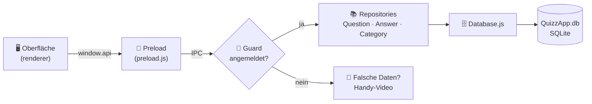

<div align="center">

# ❓ QuizzApp · Autorentool

### Hinter jeder guten Quizfrage steckt jemand, der sie sich ausgedacht hat.
*Das hier ist sein Werkzeug.*


</div>

---

## 🎬 Worum geht's?

Die **QuizzApp** (Android, Kotlin) ist die Bühne: Spieler raten, grübeln, verzweifeln.
Das **Autorentool** ist der Backstage-Bereich. Hier legen wir Kategorien an, schreiben Fragen,
verteilen Antworten (eine richtige, der Rest gemeine Falschen) und hängen bei Bedarf ein Bild dran.

Alles landet direkt in der SQLite-Datenbank `QuizzApp.db`. Kein Server, kein Umweg, kein Drama.

## ✨ Was kann es?

| | Feature | Kurz erklärt |
|---|---|---|
| 🗂️ | **Kategorien** | Anlegen, umbenennen, löschen, und man sieht sofort, wie viele Fragen drinstecken |
| ❓ | **Fragen** | Text, Kategorie, Schwierigkeit und optional ein Bild (PNG, JPG, GIF, WebP bis 2 MB) |
| 🎯 | **Antworten** | Beliebig viele, mindestens 4: genau **eine** richtige und mindestens drei falsche |
| 🔍 | **Suche & Filter** | Nach Text, Kategorie und Schwierigkeit, live |
| 🚦 | **Farbcodes** | Leicht ist 🟢 grün, mittel 🟠 orange, schwer 🔴 rot |
| 🔐 | **Anmeldung** | Das ist ein Dev-Tool, also kommt nicht jeder rein |
| 📱 | **Easter Egg** | Wer sich falsch anmeldet, bekommt ein Video auf einem Handy zu sehen. Mehr wird nicht verraten |

## 🚀 Loslegen

Du brauchst [Node.js](https://nodejs.org) (aktuelle LTS-Version) und Git.

```bash
git clone <unsere-repo-url>
cd LeBoWo-Quizapp
npm install
npm start
```

Die App sucht die Datenbank unter `data/QuizzApp.db`. Liegt sie woanders, fragt sie dich beim Start.

### 🔐 Anmelden

Jeder aus dem Team hat einen eigenen Zugang. Benutzername ist der kleingeschriebene Name
(`boehm`, `leander`, `wolkan`). Das Passwort kennt das Team.

Neues Passwort oder neuer Autor:

```bash
node scripts/set-password.js <benutzername> <neues-passwort> [Anzeigename]
```

Danach `data/authors.json` committen, damit alle dasselbe haben.
Gespeichert werden nur gesalzene scrypt-Hashes, niemals Klartext.
Nach 5 Fehlversuchen ist der Benutzername 30 Sekunden gesperrt.

### 📱 Das Video austauschen

Das Handy spielt `assets/login-fail.mp4`. Eigenes Video drauflegen, gleicher Dateiname, fertig.
Am besten im Hochformat (9:19), als MP4 mit H.264.

## 🧠 So hängt alles zusammen



Die Oberfläche darf nie direkt an die Datenbank. Sie kennt nur `window.api`.
Jeder Aufruf läuft über den Hauptprozess, und der prüft zuerst, ob überhaupt jemand angemeldet ist.

## 🗺️ Projektstruktur

```
LeBoWo-Quizapp/
├── assets/                  Medien (u. a. login-fail.mp4)
├── data/
│   ├── QuizzApp.db          die Datenbank
│   └── authors.json         Zugänge (nur Hashes)
├── scripts/
│   └── set-password.js      Passwort setzen / Autor anlegen
└── src/
    ├── main/                Hauptprozess (hat Zugriff auf Datenbank und Dateien)
    │   ├── main.js
    │   ├── auth/            AuthService: Anmeldung und Sperre
    │   ├── database/        Database + Repositories
    │   └── ipc/             Kanäle zwischen Oberfläche und Hauptprozess
    ├── preload/             die sichere Brücke (window.api)
    └── renderer/            Oberfläche (HTML, CSS, JS)
        ├── css/
        └── js/
            ├── ui/          gemeinsame Bausteine (Dialog, Meldung, …)
            └── views/       Fragen, Kategorien, Anmeldung
```

## 🧪 Bekannte Eigenheiten

- 🐛 In der Tabelle `answer` heißt eine Spalte **`answered_incorreclty`** (Tippfehler im Schema).
  Der Code schreibt sie absichtlich genauso. **Bitte nicht reparieren**, sonst geht nichts mehr.
- 🗑️ Eine Kategorie mit Fragen lässt sich nicht löschen. Erst die Fragen verschieben oder löschen.
- 🔒 Die Anmeldung schützt das **Tool**, nicht die Datenbankdatei. Wer die `.db` direkt öffnet,
  braucht dafür kein Passwort.
- 🔊 Das Fehlversuch-Video hat Ton. Vor der Präsentation Lautstärke prüfen.

## 🆘 Hilfe, es geht nicht

| Problem | Lösung |
|---|---|
| Fehler zur SQLite-Bibliothek | Electron ist zu alt: `npm install electron@latest` (ab Version 35 nötig) |
| „database is locked“ | DB Browser oder ein anderes Programm hat die Datenbank offen, bitte schließen |
| „Die Benutzerdatei data/authors.json fehlt“ | `git pull`, die Datei kommt aus dem Repository |
| Das Handy zeigt nur „Zugriff verweigert“ | Es fehlt `assets/login-fail.mp4` |

## 👥 Das Team

<div align="center">

**Boehm · Leander · Wolkan**

*Drei Köpfe, ein Repository, null Merge-Konflikte (fast).*

© Boehm · Leander · Wolkan

</div>